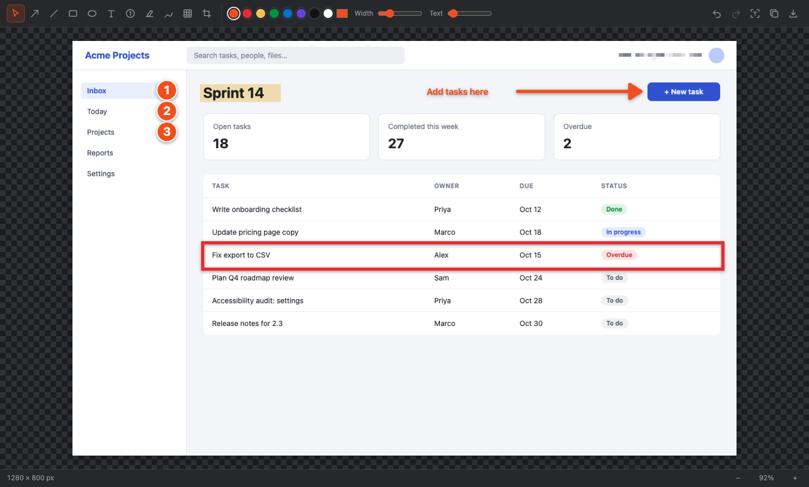
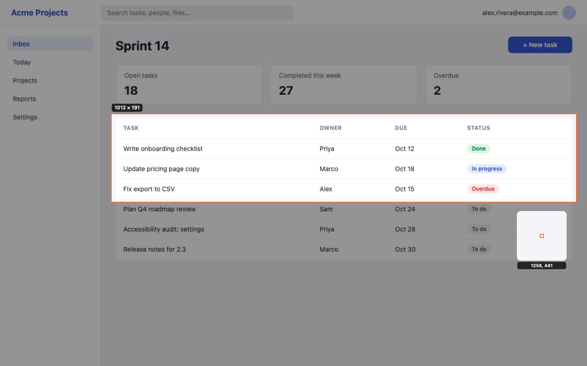
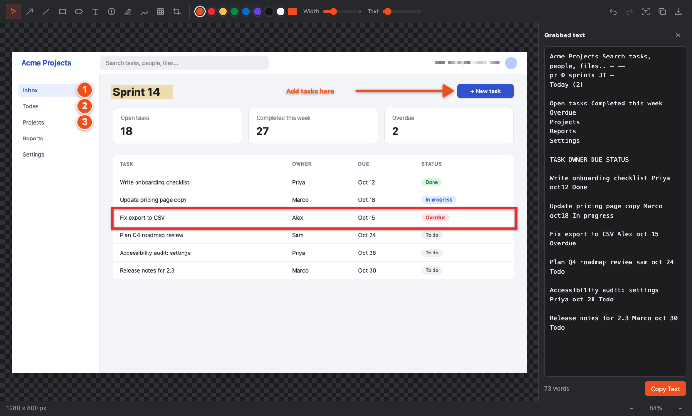

# Markcraft

**Capture, mark up and share your screen.** Markcraft is a free, open-source
screenshot and screen-recording tool for macOS, Windows and Linux. It lives in
your menu bar or system tray: press a shortcut, drag over what you need, then
annotate it with arrows, boxes, numbered steps, highlights and redactions.

[](https://github.com/lecrane54/markcraft/actions/workflows/build.yml)



## Features

- **Capture anything:** a region you drag out, a single window, or the whole
  screen. The screen freezes while you select, with a magnifier and live pixel
  size for precise edges.
- **Annotate:** arrows, lines, rectangles, ellipses, text, auto-numbered steps,
  highlighter, freehand pen, pixelate for redacting sensitive details, and crop.
  Full undo and redo.
- **Scrolling capture:** select a scrolling area, scroll, and get one tall image.
  Sticky headers and footers appear once, not on every screen.
- **Grab text (OCR):** pull the text out of any capture to copy and paste. It
  works offline, so nothing leaves your machine.
- **Screen recording:** record an area or a whole screen, with optional
  microphone narration and a webcam bubble. Saves as MP4.
- **Copy, save or keep editing:** copy straight to the clipboard, export PNG or
  JPEG, or save a `.markcraft` file to change the annotations later.

<table>
  <tr>
    <td width="50%"></td>
    <td width="50%"></td>
  </tr>
  <tr>
    <td align="center"><sub>Select a region on the frozen screen</sub></td>
    <td align="center"><sub>Grab the text from a capture</sub></td>
  </tr>
</table>

## Download

Get the latest installer from
**[Releases](https://github.com/lecrane54/markcraft/releases/latest)**:

| Platform | File |
| --- | --- |
| macOS, Apple Silicon (M1 and later) | `Markcraft-…-mac-arm64.dmg` |
| macOS, Intel | `Markcraft-…-mac-x64.dmg` |
| Windows (most PCs) | `Markcraft-…-win-x64.exe` |
| Windows on ARM | `Markcraft-…-win-arm64.exe` |
| Linux | `Markcraft-…-linux-x86_64.AppImage` (or `-arm64`) |

Releases aren't code-signed yet, so the first launch needs one extra step:

- **macOS:** right-click Markcraft in Applications → **Open** → **Open**. On
  your first capture, allow Markcraft under System Settings → Privacy & Security
  → **Screen & System Audio Recording**, then reopen it.
- **Windows:** if SmartScreen says "Windows protected your PC", click
  **More info → Run anyway**.
- **Linux:** make the AppImage executable (`chmod +x Markcraft-*.AppImage`) and
  run it.

## Using Markcraft

Use the shortcuts, or click the viewfinder icon in the menu bar or system tray.

| macOS | Windows / Linux | Action |
| --- | --- | --- |
| ⌃⇧1 | Ctrl+Shift+1 | Capture a region. Drag a rectangle, click for the whole screen, Esc to cancel. |
| ⌃⇧2 | Ctrl+Shift+2 | Capture a window you pick from a list |
| ⌃⇧3 | Ctrl+Shift+3 | Capture the screen under the pointer |
| ⌃⇧4 | Ctrl+Shift+4 | Scrolling capture. Select the area, click **Start**, scroll down slowly, click **Done**. |
| ⌃⇧5 | Ctrl+Shift+5 | Record the screen. Select an area, choose mic/webcam, click **Record**. |

On macOS, ⌘⇧3/4/5 stay with the built-in screenshot tool.

### Editor

| Key | Tool | | Key | Tool |
| --- | --- | --- | --- | --- |
| V | Select / move | | N | Numbered step |
| A | Arrow | | H | Highlighter |
| L | Line | | P | Pen |
| R | Rectangle | | B | Pixelate (redact) |
| E | Ellipse | | C | Crop (drag, then Enter) |
| T | Text | | Delete | Remove the selection |

| macOS | Windows / Linux | Action |
| --- | --- | --- |
| ⌘Z / ⇧⌘Z | Ctrl+Z / Ctrl+Shift+Z | Undo / redo |
| ⌘C | Ctrl+C | Copy the annotated image |
| ⇧⌘T | Ctrl+Shift+T | Grab text |
| ⌘S / ⇧⌘S | Ctrl+S / Ctrl+Shift+S | Save / Save As (PNG, JPEG or editable `.markcraft`) |
| ⌘0 / ⌘9 | Ctrl+0 / Ctrl+9 | Actual size / fit to window |

### Where files go

- Every capture's original is kept in `Pictures/Markcraft`. You can turn this off
  in the tray menu under **Auto-save Captures**.
- Recordings are saved to `Movies/Markcraft` (macOS) or `Videos/Markcraft`
  (Windows/Linux).

## Status

Markcraft is new (0.1). Capture, the editor, OCR and packaging are tested on
macOS. Windows and Linux builds are produced by CI but haven't had much hands-on
testing yet, so [bug reports](https://github.com/lecrane54/markcraft/issues) are
very welcome.

Known gaps:

- Scrolling capture is manual and downward-only. You scroll; Markcraft doesn't
  scroll for you yet.
- No video trimming yet. Recordings can be played, saved and shown in the folder.
- No system-audio recording yet, only the microphone.
- On Linux under Wayland, capture goes through the desktop's screen-sharing
  prompt and global shortcuts have to be set in your desktop settings. X11 works
  normally. Some desktops need an AppIndicator extension for the tray icon.

## Building from source

Requires Node.js 22.12 or newer.

```sh
git clone https://github.com/lecrane54/markcraft.git
cd markcraft
npm install
npx install-electron   # npm skips install scripts by default; this fetches Electron
npm run dev            # run with hot reload
```

When running from source on macOS, screen-recording permission goes to
**Electron** rather than Markcraft.

| Command | What it does |
| --- | --- |
| `npm test` | Unit tests: scrolling-capture stitcher, recording path |
| `npm run typecheck` | TypeScript check |
| `npm run build && npx electron test/smoke.cjs out.png` | Drives the real editor: draws with every tool, checks undo/redo by comparing pixels |
| `npm run build && npm run screenshots` | Regenerates the README screenshots in `docs/screenshots/` |
| `npm run pack` | Unpacked app for this machine, for a quick test |
| `npm run dist:mac:unsigned` / `dist:win` / `dist:linux` | Installers in `dist/`. All three can be built on a Mac. |

### Releases

Every push to `main` runs [the build workflow](.github/workflows/build.yml), which
type-checks, tests and builds each platform on its own OS. Pushing a version tag
(`git tag v0.2.0 && git push --tags`) also creates a draft GitHub release with all
the installers attached.

Signing is optional and switches on when these repository secrets exist:

- **macOS** (removes the right-click → Open step): `MAC_CERT_P12_BASE64`,
  `MAC_CERT_PASSWORD`, `APPLE_ID`, `APPLE_APP_SPECIFIC_PASSWORD`, `APPLE_TEAM_ID`.
  Requires the Apple Developer Program.
- **Windows** (removes the SmartScreen warning): `WIN_CERT_PFX_BASE64`,
  `WIN_CERT_PASSWORD`.

### How it works

| Area | Implementation |
| --- | --- |
| Capture | `desktopCapturer` freezes each display at native resolution. A preloaded, hidden overlay window per display handles selection, so the overlay appears in about 10 ms. The crop comes from the lossless image. |
| Window capture | `getDisplayMedia` on the chosen window, keeping one full-resolution frame |
| Editor | [Fabric.js](https://fabricjs.com) canvas. The capture is a locked background, and annotations are objects in image-pixel coordinates. Undo snapshots refer to images instead of copying them. |
| Scrolling capture | Samples the area every 100 ms and matches per-row signatures to find each scroll offset, detecting sticky headers and footers ([`stitcher.ts`](src/renderer/scroll/stitcher.ts)) |
| OCR | [tesseract.js](https://github.com/naptha/tesseract.js) with bundled English data. The engine warms up when an editor opens and unloads after 5 idle minutes. |
| Recording | `MediaRecorder` (MP4/H.264). A whole-screen recording goes straight to the encoder; crops and the webcam bubble are composited on a canvas. Chunks stream to disk. |

The app icon is generated from [`build/icon.svg`](build/icon.svg) with
`npm run icon`. Builds ship only English Electron UI strings and the three
tesseract engine variants Node actually loads, which keeps installers around
100–125 MB.
